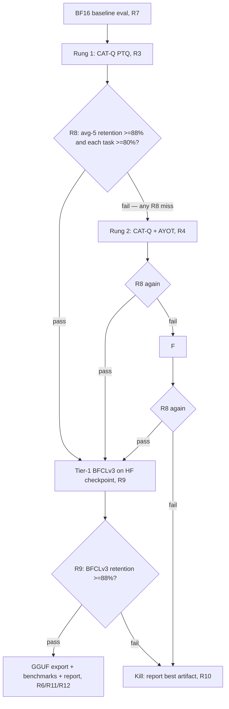

# LFM3-1.7B Ternary Compression - Plan

## Goal Capsule

- **Objective:** a verified ternary (1.58-bit) build of LiquidAI LFM3-1.7B exists as a servable GGUF, its quality is measured against the model's own BF16 baseline on a fixed eval set, its decode speed is measured against BF16 and an NVFP4 build of the same model, and a report states the honest retention numbers without the 95% or 98.2% claims this size class does not support.
- **Means:** PTQ-first escalation — CAT-Q reconstruction on 512 C4 samples, then CAT-Q with AYOT self-generated calibration, then a 102M-token QAT run — with kill gates between rungs (KTD1).
- **Authority:** this plan's Requirements govern; the cited papers and repos are method references, not contracts.
- **Stop conditions:** a rung misses its five-task gate with no escalation rung remaining, or the best achievable five-task average retention is below 80%, or tier-1 BFCLv3 retention below 88% on a rung that otherwise passes — the project dies at that gate and the report says why.
- **Execution profile:** one PR containing the pipeline code and the results report; execution happens on rented notebook GPUs, not this machine (no GPU, ~7 GB RAM).
- **Who finishes:** the executor runs each rung in order and stops at the first gate that kills the project.

---

## Product Contract

### Summary

Compress LFM3-1.7B to packed ternary weights via post-training quantization, escalating through three calibrated rungs only as far as measured quality demands, then export a servable artifact and report quality retention and decode speed honestly.

### Problem Frame

Ternary weight quantization promises a ~4.6× smaller model and ~3× decode speedup at 1.7B scale, but published results at this size are thin and the loudest numbers (Bonsai's "87.8%") turn out to be retention ratios that hide a 20-point collapse on tool calling — the task LFM3 exists for. A ternary LFM3 that silently destroys function calling is worse than no artifact at all, so the work is gated: every rung must prove itself on a fixed eval set before more compute is spent, and the deliverable includes the measurement machinery, not just the weights.

### Requirements

**Model and pipeline**

- R1. Quantize LiquidAI LFM3-1.7B (`Lfm3ForCausalLM`, 24 layers: 13 conv, 6 full-attention, 5 sliding-attention) to ternary weights on all matmul tensors — attention q/k/v/o and gate projections, every block's MLP w1/w2/w3, and conv-block in/out projections.
- R2. Keep BF16: the depthwise conv kernel (7 taps, no bias), all norms, tied embeddings/LM head, and all recurrent/cache state.
- R3. Implement the CAT-Q recipe (LM modulation + softened ternarization in a sliding-layer reconstruction, g=128, 512×2048-token C4 calibration, ~60 epochs) as rung 1, since the released BitTern repo ships no training code.
- R4. Implement AYOT calibration (self-generated reasoning traces, ~4M tokens, domain-matched questions) as rung 2, fired only when rung 1 misses its gate.
- R5. Implement the 102M-token QAT rung (non-learnable absmean g=128, STE, frozen-teacher KD) as rung 3, fired only when rungs 1-2 miss.
- R6. Export the passing weights as a packed group-128 GGUF servable under a real runtime, and record which runtime that is.

**Evaluation and gates**

- R7. Establish the BF16 baseline on the five-task set (PIQA, ARC-E, ARC-C, HellaSwag, Winogrande via lm-eval) before any quantization rung is judged.
- R8. After each rung, evaluate the same five tasks; pass requires average ≥88% of the BF16 average and every task ≥80% of its BF16 score.
- R9. Evaluate tier-1 as BFCLv3 retention on the HF checkpoint produced by the first rung that passes R8; kill the project when retention <88%.
- R10. Kill the project when the best achievable tier-0 average retention is <80%, and record which rung produced the best artifact for the report.

**Benchmarks and reporting**

- R11. Benchmark decode throughput of the ternary GGUF, the BF16 GGUF, and an NVFP4 LFM3 GGUF (upstream llama.cpp, PR #31608) with llama-bench on the same GPU and context settings.
- R12. Report measured numbers only: per-task scores and retention, BFCLv3 retention, file size, decode tokens/sec. No 95% or 98.2% claims; the Bonsai precedent is cited as a retention-ratio caution, not a target.

### Success Criteria

- The deliverable is a GGUF that loads and generates, plus a report where every quality and speed number was measured on this model in this pipeline.
- Tier-0 and tier-1 gates either pass on a surviving rung or kill the project with the evidence recorded.

### Scope Boundaries

- Embedding ternarization is out: tied embeddings/LM head stay BF16 (Bonsai quantizes them, BitTern does not; skipping them costs ~0.26 GB of the ~0.7 GB artifact).
- INT4/IQ2 comparisons, speculative decoding, and multimodal LFM3-VL are outside this product's identity.

#### Deferred to Follow-Up Work

- Upstreaming an LFM3 tensor map or packed-ternary kernel to llama.cpp.

### Key Decisions

- **PTQ-first, escalate only on measured failure** (session-settled: user-directed — chosen over QAT-only or PTQ-only: QAT cost is only justified when PTQ fails). Governs R3, R4, R5.
- **Matrices-only ternarization** (session-settled: user-directed — chosen over full-model ternary: conv/norm/state stay BF16). Governs R1, R2.
- **Kill gates are product requirements, not advisory thresholds** — the report exists to make a dead project legible. Governs R9, R10.

---

## Planning Contract

### Key Technical Decisions

- KTD1. **Three-rung escalation: CAT-Q → CAT-Q+AYOT → QAT.** Direct PTQ-fail→QAT wastes the 102M-token budget when the failure was calibration data, not capacity. AYOT is the ScaleQ-1.58 fix for exactly the collapse mode (near-zero scores on generation-heavy tasks) BFCLv3 would punish. (session-settled: user-directed — chosen over PTQ-fail→QAT.)
- KTD2. **Per-rung scale recipe: learnable LM factors for PTQ rungs, non-learnable absmean g=128 for QAT.** CAT-Q's published gains come from learnable δμ/δα/δΔ group factors; non-learnable absmean is validated for QAT-from-pretrained (Ternary Mamba), where learnable raw scales collapse ~90% of weights to zero. (session-settled: user-directed — chosen over one recipe across rungs: the Ternary Mamba constraint applies to QAT, not PTQ.)
- KTD3. **Reimplement CAT-Q on a SliderQuant-style skeleton.** BitTern releases eval and export code only; the LM+ST loop is re-derived from the paper for Lfm3ForCausalLM (`transformers>=5.12.1`, `trust_remote_code=True`), with deep-optimization/SliderQuant evaluated as the base. Rejected: waiting for the release — no date, and the plan is executable now.
- KTD4. **Export path A: BitTern's checkpoint→GGUF writer (`quantize/gguf_export.py`) extended with an LFM3 tensor map, producing packed g128 ternary for the PrismML llama.cpp fork.** Path B, if the fork's rebase predates the upstream LFM3 merge (PR #31252): map the same tensors to upstream Q2_0_g64 or TQ2_0 and benchmark on stock llama.cpp. Rejected: writing a new GGUF kernel — the fork already is that kernel.
- KTD5. **Eval harness = lm-eval avg-5 on PIQA/ARC-E/ARC-C/HellaSwag/Winogrande** — identical to BitTern's `auto_test_one.sh`, so rung scores are comparable to published CAT-Q numbers. Tier-1 uses the local BFCL harness only if it already measures LFM3-style tool calls; otherwise vLLM + EvalScope as the Bonsai card used.
- KTD6. **Calibration data per rung:** rung 1 uses BitTern's 512 C4×2048 recipe verbatim (establishes the paper-parity baseline); rung 2 generates traces from the BF16 LFM3 itself on domain-matched questions (function-calling prompts + MetaMathQA/OpenCodeInstruct-style reasoning), ~4M tokens, disjoint from eval sets. Self-generation is the mechanism AYOT proved; teacher traces are a fallback if LFM3 self-traces are unusable.
- KTD7. **Compute: Colab Pro A100-40GB for all rungs; Kaggle T4×2/P100 only for PTQ/eval when A100 is unavailable.** The QAT rung assumes A100 with gradient checkpointing and resume-from-checkpoint because notebook sessions expire mid-run. Provisioning is documented in the plan's notebooks; the user authorizes it.
- KTD8. **Honest-claims constraint:** every reported number traces to a measurement in this pipeline. NVFP4's "~1.7×" is unverifiable at 1.7B; the report compares measured tg128 side by side and lets the ratio land where it lands.

### High-Level Technical Design

Tensor scope (owns R1/R2 mapping):

| Tensor | Treatment |
|---|---|
| attn q/k/v/o, attn gate_proj; MLP w1/w2/w3; conv in_proj/out_proj | ternary |
| depthwise conv kernel (7 taps), all RMSNorms, embed/lm_head (tied), conv+KV cache state | BF16 |

### Risks & Dependencies

- **Prism fork staleness:** upstream LFM3 support merged ~2026-10-27; if PrismML's fork predates it, path A fails and the plan falls to stock TQ2_0/Q2_0_g64 with unproven ternary-kernel speed. U6 verifies before committing.
- **AYOT self-generation quality:** LFM3-1.7B is not a reasoning model; if its traces are junk, rung 2 falls back to domain-matched plain calibration or teacher traces, and the plan records the deviation.
- **Notebook session limits:** a 102M-token QAT outlives a Colab session; the unit requires resumable checkpoints or the rung cannot complete.
- **LFM3 custom modeling code:** `trust_remote_code=True` and `transformers>=5.12.1` are hard dependencies for every training-side unit.
- **Sliding-window attention layers:** CAT-Q's sliding-layer reconstruction assumes transformer-style blocks; conv blocks need their own reconstruction treatment (state cache, not KV) — an implementation risk inside U3, not a plan blocker.

---

## Implementation Units

### U1. Environment, baseline, and gate harness

**Goal:** a Colab Pro A100 environment that loads LFM3-1.7B, runs lm-eval avg-5, and records the BF16 baseline numbers every later rung is compared against.

**Requirements:** R7, R8 scaffolding.

**Dependencies:** none.

**Files:**

- `notebooks/00_env_baseline.ipynb` — install + baseline run (Colab-targeted)
- `scripts/eval_lm_eval.sh` — task list and invocation, mirroring BitTern's `auto_test_one.sh` task selection
- `scripts/gates.py` — computes per-task and average retention vs baseline; emits pass/escalate/kill verdicts per R8/R9/R10
- `results/baseline.json` — committed BF16 scores

**Approach:** pin `transformers>=5.12.1`, load `LiquidAI/LFM3-1.7B` with `trust_remote_code=True`; run the five tasks through lm-eval on the BF16 model; write scores as JSON that `gates.py` consumes. `gates.py` is the single owner of the gate arithmetic — units report scores to it, never recompute thresholds. Pin lm-eval version, task prompt settings, and seed across every rung so retention compares like for like.

**Test scenarios:**

- BF16 model produces five numeric scores in `baseline.json` (happy path).
- `gates.py` on a synthetic {avg 89%, min task 81%} returns pass; {avg 87%} returns escalate; {avg 79%} returns kill (boundary cases).
- A missing/corrupt baseline file fails loudly, not as a 0% baseline (error path).

**Verification:** `baseline.json` contains the five scores; `gates.py` verdicts match the boundary table.

### U2. Calibration data builders

**Goal:** two corpus builders — BitTern-parity C4 samples for rung 1, and the AYOT self-trace generator for rung 2.

**Requirements:** R3, R4 (data halves).

**Dependencies:** U1 (needs the loaded BF16 model for self-generation).

**Files:**

- `scripts/build_calib_c4.py` — 512×2048-token C4 samples
- `scripts/build_calib_ayot.py` — domain-matched questions → BF16-model self-traces → [question, trace, answer] triplets, ~4M tokens
- `data/calib/` — generated corpora (gitignored; paths recorded in results)

**Approach:** C4 builder mirrors BitTern's recipe. AYOT builder samples questions disjoint from eval sets, generates traces with the BF16 model itself, and stores triplets; include function-calling-style prompts in the domain mix since BFCLv3 is tier-1. A trace-quality sanity check (sampled human/agent review of N traces) decides self-generated vs teacher fallback before rung 2 spends calibration hours.

**Test scenarios:**

- C4 builder emits exactly 512 sequences of 2048 tokens.
- AYOT builder emits well-formed triplets; generated tokens total in the 3.5-4.5M band.
- Eval-set contamination check: no AYOT question appears in PIQA/ARC/HellaSwag/Winogrande/BFCLv3 prompts (edge case).

**Verification:** corpus files exist with stated counts; contamination check clean.

### U3. CAT-Q PTQ rung for LFM3

**Goal:** the sliding-layer reconstruction quantizer — LM factors (δμ, δα, δΔ per group of 128) plus softened ternarization — producing a ternary LFM3 checkpoint, with conv blocks handled explicitly.

**Requirements:** R1, R2, R3; KTD2, KTD3.

**Dependencies:** U1, U2 (C4 corpus).

**Files:**

- `src/ternarq/` — new package: `quantizer.py` (LM+ST core), `reconstruction.py` (sliding-layer pipeline), `lfm3_adapter.py` (block-type dispatch: conv vs attention layers, conv-state handling)
- `notebooks/10_catq_ptq.ipynb` — the run
- `tests/test_quantizer.py` — unit tests for ternarization math
- `checkpoints/rung1/` — output (gitignored)

**Approach:** evaluate deep-optimization/SliderQuant as the skeleton first — if its sliding-layer loop ports, adapt it rather than rebuild. Per-layer dispatch by `layer_types`: attention blocks reconstruct on KV-cache inputs; conv blocks reconstruct on conv-state inputs with the depthwise kernel frozen BF16. ST ramp: γ=0.8, s₀→30, ~60 epochs, Δ₀=0.5, per the paper defaults.

**Technical design (directional):** per group: `Ŵ = αT + 0·μ`; LM learns δμ/δα/δΔ on normalized weights; ST transitions differentiable→hard across epochs; each layer's output reconstruction consumes the previous quantized layer's real activations.

**Test scenarios:**

- Ternarizer maps a known weight block to {-1,0,+1}·α with correct per-group scales.
- Conv blocks quantize only in/out_proj; conv kernel and norms stay BF16 bit-identical (scope edge case).
- Tied embedding is never rewritten (R2 invariant).
- Checkpoint reload produces identical logits on a fixed prompt (integration).

**Verification:** rung-1 checkpoint exists; `gates.py` receives its avg-5 scores via the eval path in U1.

### U4. AYOT rung

**Goal:** rerun the U3 pipeline with AYOT calibration data when rung 1 fails R8.

**Requirements:** R4.

**Dependencies:** U3, U2 (AYOT corpus).

**Files:**

- `notebooks/20_catq_ayot.ipynb`
- `checkpoints/rung2/` (gitignored)

**Approach:** identical quantizer and hyperparameters to U3 — only the calibration corpus swaps. The unit exists to keep rung comparisons honest; no new code beyond the notebook.

**Test expectation:** none beyond U3's — the rung is a data swap; correctness rests on U2's corpus checks and U3's tested quantizer.

**Verification:** rung-2 checkpoint evaluated through the same harness; `gates.py` verdict recorded in `results/rung2.json`.

### U5. QAT rung

**Goal:** 102M-token quantization-aware training with non-learnable absmean g=128 scales and STE, matrices-only, from the best PTQ checkpoint.

**Requirements:** R5; KTD2.

**Dependencies:** U3 or U4 (starting checkpoint), U1.

**Files:**

- `src/ternarq/qat.py` — absmean quantize-forward + STE, teacher-KD loss wiring
- `scripts/build_qat_data.py` — training corpus (domain-matched, ~102M tokens)
- `notebooks/30_qat.ipynb` — A100 run with checkpoint/resume
- `checkpoints/rung3/` (gitignored)

**Approach:** frozen BF16 teacher, KD on logits plus task loss; absmean scale recomputed per group each forward (the Ternary Mamba recipe that avoids zero-ratio collapse). Initialize from the best passing-or-closest PTQ artifact, not BF16, to spend the 102M budget recovering rather than relearning. Resumable checkpoints are mandatory (KTD7).

**Test scenarios:**

- QAT step quantizes forward and passes STE gradients to the weight (unit).
- Zero-ratio monitor: weights-collapsed-to-zero stays near ~26% band, not the ~90% collapse signature (edge case from the failure mode the recipe exists to avoid).
- Checkpoint/resume restores optimizer state mid-run (session-expiry path).

**Verification:** rung-3 artifact evaluated through the same harness; verdict recorded.

### U8. Tier-1 BFCLv3 evaluation

**Goal:** measure tool-calling retention on the surviving rung's HF checkpoint and apply the R9 kill gate before export and benchmark compute is spent.

**Requirements:** R9.

**Dependencies:** whichever rung passed R8 (U3/U4/U5), U1.

**Files:**

- `scripts/eval_bfcl.sh` — BFCLv3 run (local harness if it exists; else EvalScope+vLLM as Bonsai used)
- `results/bfcl.json`

**Approach:** evaluate the HF checkpoint directly — EvalScope+vLLM as Bonsai used, or the local BFCL harness when present; when neither can serve `Lfm3ForCausalLM` (custom modeling, `trust_remote_code`), run the BFCL harness against the HF model directly rather than skipping the gate. The packed GGUF is a lossless container, so the HF checkpoint carries the same weights at higher precision. Run BFCLv3 on the BF16 model first as the tier-1 baseline, then on the surviving rung's checkpoint; `gates.py` computes retention and the kill verdict.

**Test scenarios:**

- BF16 BFCLv3 baseline recorded before the artifact is judged.
- Retention ≥88% → pass; <88% → kill, recorded in `results/bfcl.json` (boundary).

**Verification:** `results/bfcl.json` has both scores and the verdict.

### U6. GGUF export and serving

**Goal:** convert the surviving ternary checkpoint to a loadable, generative GGUF.

**Requirements:** R6; KTD4.

**Dependencies:** whichever rung passed its gate (U3/U4/U5), U8 (tier-1 gate passed).

**Files:**

- `scripts/export_gguf.py` — extends BitTern's `quantize/gguf_export.py` with the LFM3 tensor map
- `scripts/serve_check.sh` — load + generate smoke under the chosen runtime

**Approach:** path A first — adapt BitTern's checkpoint→GGUF writer to LFM3's tensor names (conv `in_proj`/`out_proj`, q/k-norm, per-layer-type rope metadata, tied embeddings) targeting the PrismML fork's packed g128 type. Verify the fork contains the upstream LFM3 merge before committing; if stale, path B writes upstream-compatible Q2_0_g64/TQ2_0 and serves on stock llama.cpp.

**Test scenarios:**

- Exported GGUF loads and produces coherent text on a fixed prompt (integration).
- Tensor census: every expected matrix is packed ternary, every BF16-scoped tensor is BF16 (R1/R2 boundary check).
- File size lands near the predicted ~0.7-0.9 GB (sanity, not a gate).

**Verification:** `llama-cli` (fork or stock, recorded which) generates; tensor census printed.

### U7. Benchmarks and report

**Goal:** measured decode-speed and quality numbers, written up honestly.

**Requirements:** R11, R12.

**Dependencies:** U6 (ternary GGUF), U8 (tier-1 passed); NVFP4 and BF16 GGUFs of LFM3-1.7B built in the same environment.

**Files:**

- `scripts/build_baseline_ggufs.sh` — llama.cpp convert + quantize for the BF16 and NVFP4 variants of the same checkpoint
- `scripts/bench.sh` — llama-bench tg128/pp512 for the three variants, same GPU/context
- `REPORT.md` — per-task scores, retentions, BFCLv3, sizes, speeds, and which rung/runtime produced the artifact
- `results/benchmarks.json`

**Approach:** `build_baseline_ggufs.sh` produces the BF16 and NVFP4 comparators in the same environment before any benchmark runs. If upstream llama.cpp cannot convert an LFM3 hybrid GGUF to NVFP4 (conv tensors or arch unsupported by PR #31608's path), substitute Q4_K_M as the INT4-class comparator and record the substitution in REPORT.md — the two-way comparison still runs. llama-bench on the same GPU for all variants; where runtimes differ (fork vs stock), benchmark the ternary file on its serving runtime and say so — cross-runtime numbers get labeled, not blended. REPORT.md leads with the measured retention table and the gate verdicts; the Bonsai 58.47/66.57 precedent is cited only to explain why retention, not absolute scores, is the honest metric at 1.7B.

**Test scenarios:**

- Benchmark JSON contains tg128 for all three variants under identical settings.
- REPORT.md contains no unmeasured quality claims (audit pass over the file: every number traces to a results file).

**Verification:** the report exists with all measured numbers; benchmarks reproducible from `scripts/bench.sh`.

## Verification Contract

- Tier-0 evals: `scripts/eval_lm_eval.sh` (lm-eval, five tasks) — the only score source `gates.py` trusts.
- Gates: `scripts/gates.py` prints pass/escalate/kill with the arithmetic shown; every rung's verdict lands in `results/`.
- Serving: `scripts/serve_check.sh` must generate coherent output from the exported GGUF.
- Benchmarks: `scripts/bench.sh` — exit criterion is measured tg128 for ternary, BF16, and NVFP4 under identical settings, recorded in `results/benchmarks.json`.
- Unit tests: `pytest tests/` on this box (CPU — quantizer math is testable without GPU).

## Definition of Done

- Either a servable ternary GGUF with all gates passed, or a kill verdict at a named gate with the best artifact identified.
- `REPORT.md` contains only measured numbers; tier-0 and tier-1 retentions computed by `gates.py`.
- Benchmarks for all three variants recorded.
- Experimental dead ends (failed rung notebooks, abandoned export formats) removed or clearly marked — no half-wired alternates left in the tree.

---

## Appendix

### Sources & Research

- CAT-Q paper (arXiv:2606.26650, ICML 2026 oral) + `IntelChina-AI/BitTern` `projects/cat-q/` — recipe owner (g=128, 512×2048 C4, γ=0.8, s₀=30, m=60); eval/export code only, no training code.
- ScaleQ-1.58 / AYOT (arXiv:2608.01078) — self-generated traces, ~4M tokens; fixes reasoning collapse vs C4 calibration.
- Ternary Mamba (arXiv:2606.18114) — non-learnable absmean g=128 for QAT; learnable scales collapse; 102M-token budget source; SSM-specific, applied here only to the QAT rung.
- prism-ml/Ternary-Bonsai-1.7B-gguf — 58.47 vs 66.57 avg over six tasks (87.8% retention); BFCLv3 51.0 vs 71.8 (~71% retention) is the tier-1 caution.
- LFM3-1.7B `config.json`/`modeling_lfm3.py` — layer_types, tied embeddings, conv_L_cache=7; upstream llama.cpp LFM3 support (PR #31252) and NVFP4 enablement (PR #31608).
- Research dossier: `/tmp/compound-engineering-1000/ce-plan-research/aaa161e2/web.md` (machine-local, best effort).
